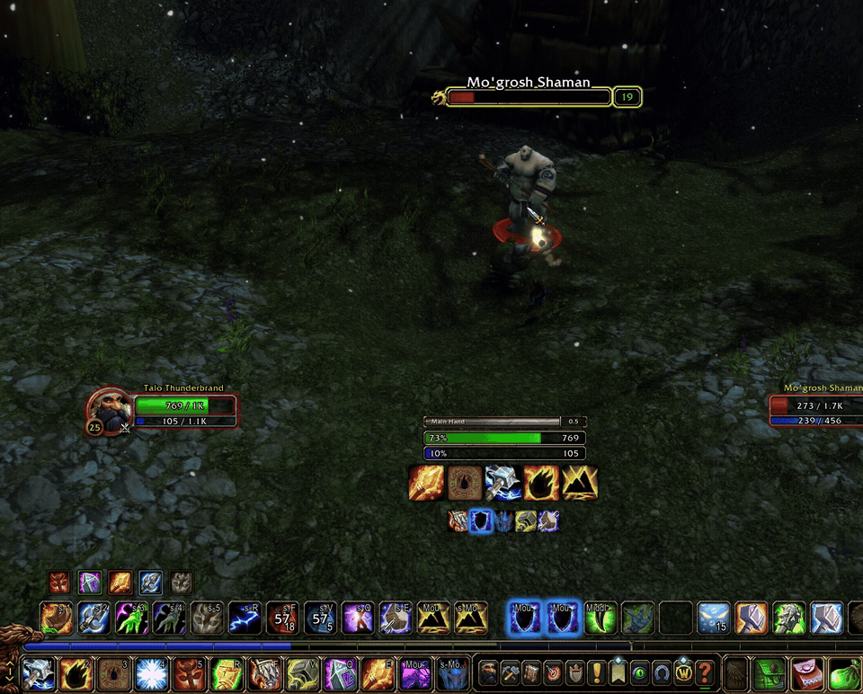
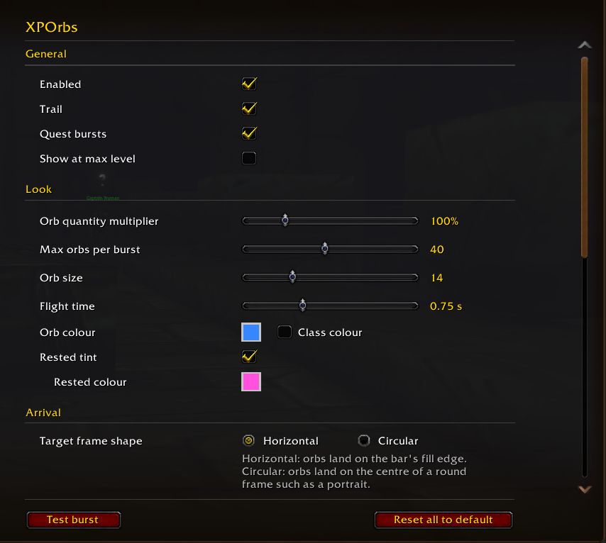

# XP Orbs

[](LICENSE)
[](https://github.com/Talotan/XPOrbs/releases)

A World of Warcraft addon for the Forever client. When you gain experience, a burst of orbs flies to your XP bar. For a
kill the burst starts at the mob, and rested experience is drawn in a second colour.

<!-- hero:  (add once captured) -->

The number of orbs grows with the share of the current level that the gain gave, so a big kill looks bigger than a
trivial one.

## Compatibility

- WoW Forever only (`## Interface: 16001`). It has not been tested on Retail or any Classic client.
- The English client is tested. Other languages should work, because the XP message patterns are built from the
  client's own strings, but this is untested.
- The default UI XP bar, or another frame you pick with `/xporbs pick`.

## Installation

### CurseForge

Open the CurseForge app, choose the WoW Forever flavor (instance), and search for XP Orbs. Some users had to reinstall
the CurseForge app before the Forever flavor appeared.
<!-- TODO: link to CurseForge page -->

### Wago

Open the Wago app, choose WoW Forever, and search for XP Orbs.
<!-- TODO: link to Wago page -->

### Manual

1. Download `XPOrbs-<version>.zip` from [GitHub Releases](https://github.com/Talotan/XPOrbs/releases).
2. Extract it into `World of Warcraft\_forever_\Interface\AddOns\` so that you end up with
   `AddOns\XPOrbs\XPOrbs.toc`. The folder must be named `XPOrbs`.
3. `/reload` or restart the game.

## Usage

Settings are saved per account in `XPOrbsDB`. The options panel is under Esc > Options > AddOns > XP Orbs, or
`/xporbs options`.



| Command | What it does |
|---|---|
| `/xporbs help` | List the commands. |
| `/xporbs options` | Open the options panel. |
| `/xporbs status` | Print the version, the settings that matter, and the state of each part of the addon. |
| `/xporbs test [pct] [rested] [popstream\|crossfade\|stream]` | Fire a test burst. `pct` is the percent of a level it represents (default 5, up to 1000). `rested` colours part of it as rested. A style name overrides the saved style for this burst. |
| `/xporbs style popstream\|crossfade\|stream` | Set the kill style. With no argument, print the current one. |
| `/xporbs pop on\|off` | Shortcut: `on` sets `popstream`, `off` sets `stream`. |
| `/xporbs pick` | Arm the frame picker, then left-click the XP bar. Right-click or wait 15 s to cancel. |
| `/xporbs pick clear` | Forget the picked frame and go back to auto-detection. |
| `/xporbs debug on\|off` | Turn the debug log on or off. |
| `/xporbs reset` | Restore every setting to its default. |

The panel has these settings: enable, trail, quest bursts and show at max level; orb quantity, maximum orbs per
burst, orb size and flight time; orb colour (or your class colour), rested tint and rested colour; the shape of the
target frame, a landing offset, and the arrival glow with its intensity; the kill style; the XP bar frame; and the
debug log. The panel also has a test button and a reset button.

At the level cap nothing is drawn unless "Show at max level" is on.

## How it works

### Kill detection

Several events describe one kill, and a small matcher (`logic/KillMatcher.lua`) pairs them so that each gain
produces exactly one burst.

- `UNIT_DIED` carries the dead unit's GUID. If it matches a tracked hostile nameplate, the kill has a plate (tier 1).
- If the nameplate is removed while the unit is dead and no `UNIT_DIED` matched, that also counts as a death (tier 2).
- `CHAT_MSG_COMBAT_XP_GAIN` carries the mob name and the XP amount. The message patterns are built from the client's
  own `COMBATLOG_XPGAIN_*` strings, so they follow the client's language (only English has been tested). A message
  with no death to pair with (for example, the GUID was unreadable) still produces a burst after 0.5 s, just without
  a plate (tier 4).
- `PLAYER_XP_UPDATE` gives the XP delta. A delta equal to a pending kill's amount claims that kill, so it is not also
  shown as a second burst. A delta that no kill claims within 0.4 s is non-kill XP.

`COMBAT_LOG_EVENT_UNFILTERED` is not available to addons on this client, so the addon never uses it.

### Orb count

The count depends on the gain as a share of the XP needed for the level:

```
pct = gain / xpToLevel * 100
orbs = round((3 + 5 * sqrt(pct)) * quantity / 100), clamped to 1 .. maximum
```

`quantity` defaults to 100 and the maximum to 40. For example, 5% of a level gives 14 orbs, 10% gives 19 and 25% gives
28. When the formula asks for more than the maximum, the orbs are drawn larger instead, up to 1.5 times.

### Where orbs start

Nameplates are restricted regions on this client. An addon cannot read their position or size, and a frame anchored
to a plate cannot also be anchored to anything else. XP Orbs therefore never measures a plate, and it works around the
restriction in two ways.

- It draws a short burst on a tiny frame that is anchored to the plate and nothing else. Because the frame follows the
  plate, the burst appears on the mob wherever it is on screen. Nothing on that frame is ever measured.
- It estimates where the mob was on screen. While you hover a hostile unit, the addon records the cursor position
  against the unit's GUID. When that unit dies, a sample from the last second or so is used as it is, and its weight
  fades to zero at 3 seconds. The sample is raised by 40 px, because the cursor sits on the body and the plate sits
  above it. Without a usable sample the estimate is a fixed point at the horizontal centre of the screen and 58% of
  its height.

The stream then flies in screen space from that point to the destination.

### Styles

- `popstream` (default): up to 12 orbs pop out around the plate for about half a second, then the full stream flies
  from the estimated position to the bar. Without a plate, only the stream is drawn.
- `crossfade`: the orbs first bloom on the plate, then fly from the estimated position. The plate-anchored copy fades
  into a screen-space copy during the first part of the flight.
- `stream`: only the screen-space stream, with no plate frame.

Non-kill XP always uses a plain stream.

### Destination

Orbs land on the fill edge of the XP bar: the frame you picked with `/xporbs pick`, otherwise the first visible one of
`MainStatusTrackingBarContainer`, `StatusTrackingBarManager` and `MainMenuExpBar`. If the target frame shape is set to
circular, they land on the centre of the frame instead, which suits a round frame such as a portrait. The landing
point can be shifted by up to 100 px on each axis. If no frame is visible, the orbs land at the bottom centre of the
screen. The arrival glow is drawn at the landing point.

### Rested XP

Forever does not print the rested bonus in the kill message, so the addon works it out from the rested pool
(`GetXPExhaustion`). Rested kills pay 200%, and the pool drains by the whole gain, so the bonus is half of the XP the
pool covered. That share of the orbs is drawn in the rested colour; they leave slightly later and are slightly
larger. If a message does include a bonus, that value is used instead. If no drop in the pool was seen for the kill,
the addon assumes the pool covered the gain, up to what was left in it.

### Non-kill XP

Quests, exploration and other XP that no kill claims produce a burst that starts a little above the centre of the
screen. "Quest bursts" turns this off.

## Limitations

- When you did not hover the mob, the start of the stream is the fixed default point, not the mob's real position.
  The pop on the plate itself is always correct.
- A custom XP bar addon is not detected automatically. Pick its frame with `/xporbs pick`.
- Quest and exploration XP start at a fixed point instead of the quest window or the objective tracker.
- In instances, the client may hide GUIDs and names from addons. The addon then pairs events by order instead of by
  name, and a kill may have no plate, so it gets only the stream from the estimated point.

## Troubleshooting

`/xporbs status` shows the version, the destination frame in use, how many kills each matching tier has caught, and
whether each part of the addon is idle or running.

`/xporbs debug on` records a ring of the last 500 log lines in `XPOrbsDB.log`. The game writes it to
`WTF\Account\<account>\SavedVariables\XPOrbs.lua` on `/reload` or logout. The log holds counts, flags and timings
only: it never records mob names or GUIDs.

To check for Lua errors, run `/console scriptErrors 1`.

## Reporting bugs

Open an issue on [GitHub](https://github.com/Talotan/XPOrbs/issues) and include:

- the output of `/xporbs status`;
- if you can, the debug log: run `/xporbs debug on`, reproduce the problem, `/reload`, then attach
  `WTF\Account\<account>\SavedVariables\XPOrbs.lua`. It holds counts and timings only, never names or GUIDs.

## Roadmap

- Per-source origins for non-kill XP: quest turn-ins start at the quest window, exploration and so on.
- Auto-detect common XP bar replacement addons.

## Development

```
XPOrbs.toc           load order
Core.lua             defaults, saved-variable migration, slash commands, debug log
Plates.lua           hostile nameplate tracking (GUID, name, anchor frame); never measures a plate
Kills.lua            event wiring, kill matching, rested detection, hands bursts to Orbs
Mouseover.lua        cursor samples while hovering a hostile unit
Target.lua           destination (XP bar edge), frame picker
Orbs.lua             overlay, texture pool, plate-anchored frames, flight and glow
Options.lua          settings panel
logic/               pure Lua: XPParse, OrbMath, KillMatcher, MobEstimate (no WoW globals)
media/               orb, sparkle and flash textures
tools/               make_textures.py, package.py
tests/               pytest suite and the WoW API stubs
docs/                probe notes (probe-results.md) and README images
```

The tests run the addon's Lua 5.1 code under [lupa](https://github.com/scoder/lupa) against a stub of the WoW API.
The stub can drive events and time, and it emulates restricted regions so that any measurement of a plate fails a test.

```
uv run pytest -q
```

`.luacheckrc` and `stylua.toml` hold the luacheck and StyLua configuration. Neither tool is required, and
`tests/test_lint.py` stands in for the lint: it compiles every file, loads the addon in a sandbox and fails on any
global other than `XPOrbsDB` and `SLASH_XPORBS1`. Lines are at most 120 columns.

The textures are generated rather than drawn. To rebuild them (and a preview sheet):

```
uv run --with pillow python tools/make_textures.py --preview
```

To build `dist/XPOrbs-<version>.zip`, the same files the release workflow ships:

```
uv run python tools/package.py
```

Releases are built by the [BigWigsMods packager](https://github.com/BigWigsMods/packager) when a `v*` tag is pushed.

For development, link the repository into the game folder instead of copying it:

```
New-Item -ItemType Junction -Path "<WoW>\_forever_\Interface\AddOns\XPOrbs" -Target "<path to this repo>"
```

## License

Copyright (C) 2026 Talotan. XP Orbs is free software under the GNU General Public License v3.0 or later; see
[LICENSE](LICENSE).
