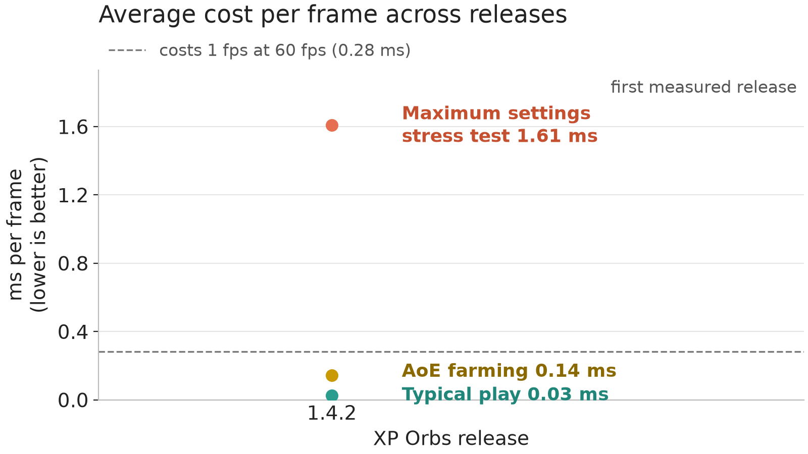
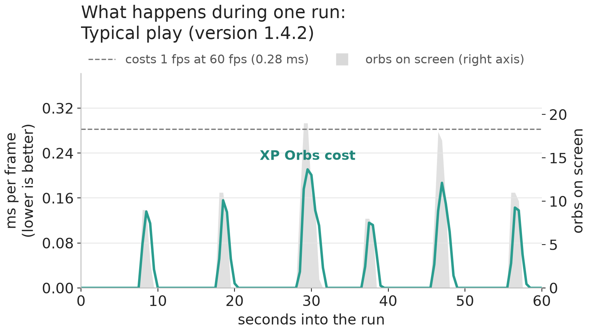
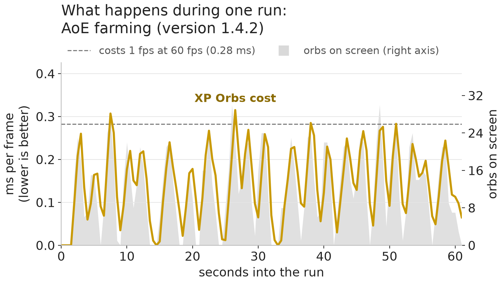
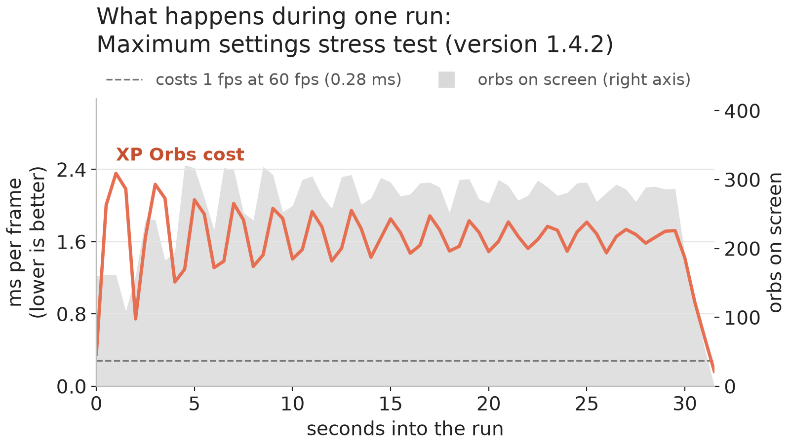

# XP Orbs performance

Every frame the game draws has a time budget. At 60 frames per second (fps) the game has 16.7 ms (milliseconds) to draw each frame. "ms per frame" below is how much of that budget XP Orbs itself uses on the CPU, so 0.5 ms per frame is about 3% of a 60 fps frame. Lower is better.

**Version 1.4.2**, measured on Ryzen 7 9800X3D, RTX 4070, 1440p, game build 1.60.1 (71139). Typical play and AoE farming each cost under 1 fps at 60 fps (0.03 and 0.14 ms per frame). The maximum-settings stress test (a worst case nobody plays in) costs about 5.3 fps at 60 fps (1.61 ms per frame).

### Version 1.4.2 at a glance

| Scenario | Average cost per frame | Worst 1% of frames | fps cost at 60 fps | fps cost at 144 fps | Verdict (at 60 fps) |
|---|---|---|---|---|---|
| Typical play | 0.03 ms | 0.22 ms | 0.1 fps | 0.5 fps | Negligible |
| AoE farming | 0.14 ms | 0.45 ms | 0.5 fps | 2.9 fps | Negligible |
| Maximum settings stress test | 1.61 ms | 2.58 ms | 5.3 fps | 27.1 fps | Moderate |

*Average cost* is what XP Orbs adds to a typical frame. *Worst 1%* is the cost of the slowest one frame in a hundred, which is what you'd feel as a hitch. *fps cost* converts the average into frames per second lost at 60 and 144 fps.

## How it changes between releases

Trends between releases appear here from the second measured release onward.

## Inside one run (version 1.4.2)

XP Orbs' cost per frame (coloured line) over the length of a test run, against how many orbs are on screen (grey area). The cost shown is after subtracting the idle baseline, the same way as in the table above. Each point averages half a second, so single-frame spikes (the Worst 1% column) are smoothed out.

Show the three run charts

## How this is measured

Each test is a scripted fight run inside the game with the addon's benchmark tool, using fixed random seeds so every release faces the same test:

- **Typical play:** a few mobs at a time, up to 3 dying together.
- **AoE farming:** many mobs dying in overlapping waves every few seconds.
- **Maximum settings stress test:** every setting at its maximum and the screen kept full of orbs, a worst case nobody plays in.

Typical play and AoE farming use the default settings. Sound is off in all tests.

The cost is measured by XP Orbs' own timers around its per-frame update and every burst of orbs it creates, minus an idle baseline measured just before the test, so only the work XP Orbs causes is counted.

The game's own addon profiler was not available or did not report XP Orbs' time for this run, so there is no cross-check figure.

Each test is repeated 3 times and the median of the repeats is shown.

- Rig: Ryzen 7 9800X3D, RTX 4070, 1440p
- Game build: 1.60.1 (71139)
- Measured: 2026-11-26

**Things to keep in mind**

- CPU time is measured precisely. GPU cost is not part of the cost columns; it only shows up indirectly as lower frame rates, and those readings are noisy.
- All numbers come from one PC. Compare releases with each other, not with other people's PCs.

---

Generated by `uv run python tools/bench/report.py render` from the files in `docs/performance/data/`.
